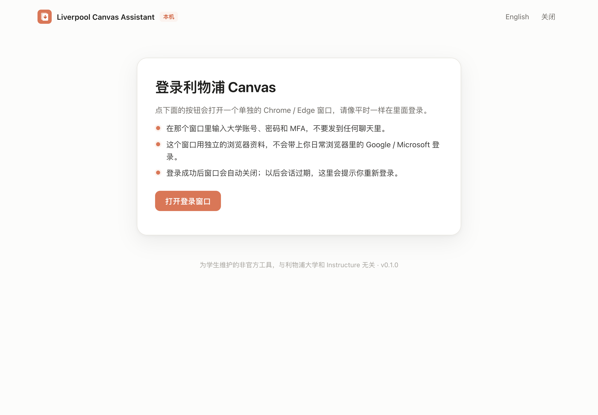
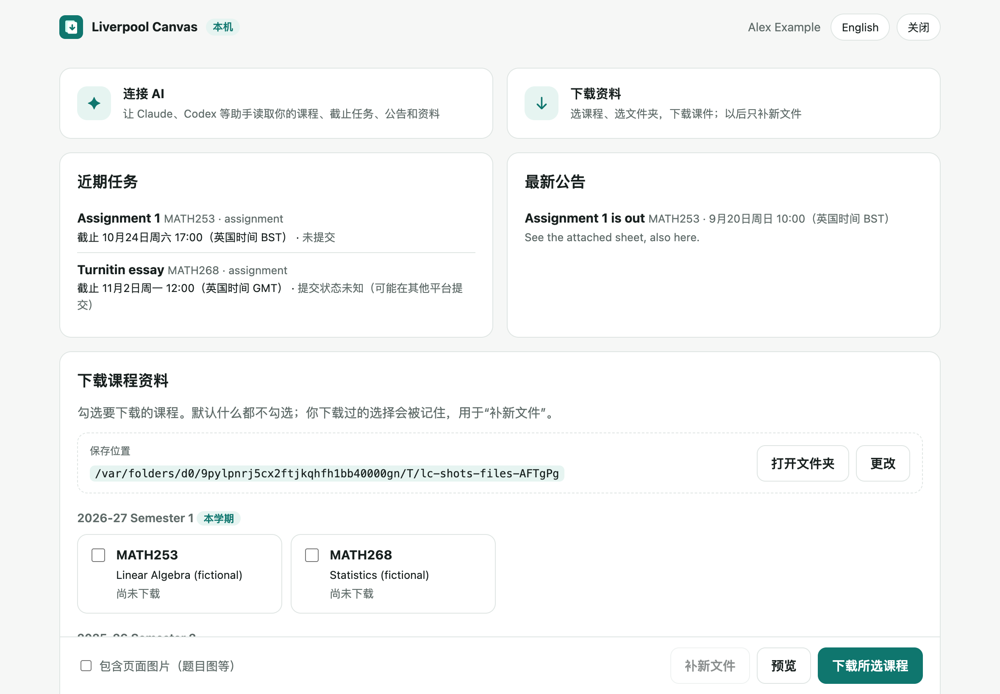
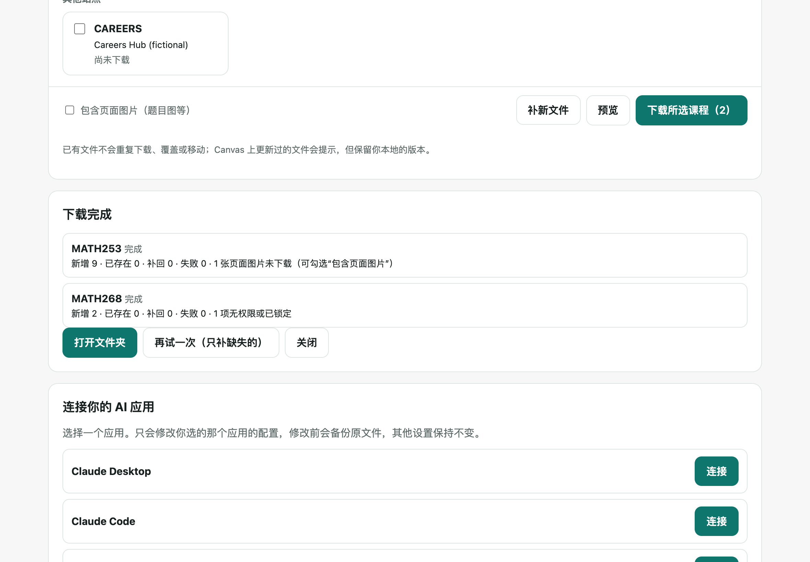

# Liverpool Canvas Assistant

把利物浦大学 Canvas（https://canvas.liverpool.ac.uk）接到你自己的 AI 助手：用学校正常登录，无需个人 Access Token。
在 Claude、Codex 等应用里查询课程、截止任务、公告、作业要求、成绩、讨论、站内信和日历，读取课件。
不用 AI 也行：本地网页或命令行按课程下载资料，以后只补本地没有的新文件。
学生维护的非官方开源工具，对 Canvas 只读。English summary below.

## 运行条件

- Node.js 22 或更新版本（已在 22 和 24 上测试）
- Google Chrome 或 Microsoft Edge（用于学校登录窗口）
- macOS 已手动测试；Windows 和 Linux 通过 GitHub Actions 上的自动测试，尚未手动操作验证（见“测试记录”）

## 启动

只需要 Chrome 或 Edge。Node.js 不用提前装：电脑上没有 Node.js 22+ 时，安装命令会从 nodejs.org 下载官方 LTS 版到 `~/.liverpool-canvas/node`，校验 SHA-256，不需要管理员密码。也不需要 Git 或 GitHub 账号。

macOS / Linux（“终端”）：

```bash
curl -fsSL https://shanyuzhang.com/liverpool-canvas/install.sh | bash
```

Windows（PowerShell）：

```powershell
irm https://shanyuzhang.com/liverpool-canvas/install.ps1 | iex
```

脚本源码：[docs/install.sh](docs/install.sh)、[docs/install.ps1](docs/install.ps1)。以后再运行同一条命令会打开菜单（接入 AI、打开下载页面、状态、重新登录）。

已经装有 Node.js 22+ 的话，也可以直接：

```bash
npx -y @shanyuzhang/liverpool-canvas@latest setup
```

`setup` 依次：确认下载文件夹（默认“文稿/Documents/Canvas”）→ 打开独立的 Chrome/Edge 窗口让你自己完成学校登录和 MFA → 让你选一个要接入的 AI 应用（也可以跳过）。接入 AI 时，会把当前版本固定安装到 `~/.liverpool-canvas/app`，AI 应用每次启动都用这份本地副本，不会每次去网上拉取。

之后常用：

```bash
npx -y @shanyuzhang/liverpool-canvas@latest web
```

```bash
npx -y @shanyuzhang/liverpool-canvas@latest sync
```

更新 AI 应用使用的本地副本：

```bash
npx -y @shanyuzhang/liverpool-canvas@latest update
```

从源码运行（开发用）：`git clone https://github.com/shanyuzhang/liverpool-canvas.git`，进入目录后 `npm install`，再用 `node bin/cli.js setup`。

## 三步

| 1. 学校登录 | 2. 课程概览 | 3. 选课下载，以后只补新文件 |
|---|---|---|
|  |  |  |

截图来自合成的测试 Canvas，课程和人名都是虚构的。

## 接入 AI 后可以问

- “列出我的课程和近期作业截止”
- “看看老师最新的公告”
- “读取这次作业要求和评分标准”
- “下载我选中的课程资料，以后只补本地没有的文件”

AI 读到的课程内容会发送给你使用的 AI 应用及其服务商，就像你把它粘贴进聊天一样；登录 cookie 和密码不会。详见 [PRIVACY.md](PRIVACY.md)。

## 命令

| 命令 | 作用 |
|---|---|
| （无参数） | 第一次运行进入 setup；之后显示菜单：接入 AI / 打开本地网页 / 状态 / 重新登录 |
| `setup` | 下载文件夹、学校登录、选择一个 AI 应用接入（`--skip-ai` 跳过） |
| `login` / `logout` | 重新登录 / 清除本机登录状态（不删除已下载文件） |
| `status` | 登录状态、下载文件夹、记住的课程 |
| `courses` | 按学期分组列出课程（`--include-past` 含往届） |
| `preview --course X` | 列出将要下载的文件，不下载 |
| `download --course X [--course Y]` | 下载课程；课程代码有多个候选时让你选，不猜测 |
| `sync` | 只为你明确选过的课程补新文件 |
| `reindex --course X` | 把下载文件夹里已有的、路径和大小都吻合的文件登记进索引（不下载、不移动、不覆盖） |
| `connect --client <id>` | 接入一个 AI 应用：`claude-desktop`、`claude-code`、`codex`、`cursor`、`windsurf` |
| `web` | 打开本地操作网页（只监听 127.0.0.1） |
| `mcp` | MCP stdio 服务（AI 应用启动它；stdout 只输出协议数据） |
| `update` | 把 AI 应用使用的本地副本更新到 npm 上的最新版本 |

所有命令支持 `--help`；需要给脚本或 AI 读取时加 `--json`。

## 下载规则

- 文件从 Files 列表、模块（分页读取）、模块里的页面、页面互相链接的页面、课程首页、公告附件和正文、作业描述、指向 Canvas 文件的模块链接里统一查找。Files 或 Pages 列表被隐藏时照样能找到。
- 同一个文件出现在多处只下载一次，并记录全部来源。
- 已下载且本地还在：跳过，不请求文件内容，不覆盖，不移动。
- Canvas 上同一文件改过：提示，保留本地版本。
- 新的 Canvas 文件与已有文件同名：另存为 `名称 (canvas-编号).ext`。
- 本地文件被删：下次补回。中断或校验失败的下载不会被当成已完成。
- 无权限、锁定、找不到的条目注明原因跳过；某个来源出错时明确标记“扫描不完整”。
- 页面正文里嵌入的图片默认不下载（多是装饰），可用 `--include-images` 或网页上的选项包含。
- 目录：`<下载文件夹>/<课程代码 (学期)>/<模块或页面>/<文件>`。
- 不做后台轮询：只在你运行或点击时检查。

## 数据位置

- 设置、登录会话、登录用的独立浏览器资料、下载索引：`~/.liverpool-canvas`（仅当前用户可读）
- 课件：你选的下载文件夹
- 环境变量：`LIVERPOOL_CANVAS_HOME`（数据目录）、`LIVERPOOL_CANVAS_DOWNLOADS`（下载目录）、`LIVERPOOL_CANVAS_BROWSER`（`chrome` / `msedge` / `chromium`）、`LIVERPOOL_CANVAS_RENEW=hidden`（会话过期时不弹登录窗口）

## MCP 工具

保留了上游 canvas-session-mcp 的全部 17 个工具（名称和必填参数不变），另加 4 个下载工具：

| 工具 | 作用 |
|---|---|
| `canvas_whoami` | 检查连接 |
| `canvas_list_courses` | 课程，本学期标记 `current_term` |
| `canvas_upcoming` | 近期/逾期待办与提交状态（英国时间；公告只显示发布时间；拿不到提交记录时标为未知） |
| `canvas_list_assignments` / `canvas_get_assignment` | 作业、要求、rubric、提交和分数 |
| `canvas_list_announcements` | 公告与附件 |
| `canvas_list_modules` / `canvas_get_page` | 模块结构、页面 |
| `canvas_list_files` / `canvas_read_file` | 统一文件发现 / 读取文件文字（已保存的直接读本地副本） |
| `canvas_save_course_files` | 下载一门课（只补缺失） |
| `canvas_list_discussions` / `canvas_get_discussion` | 讨论 |
| `canvas_grades` | 成绩与评语 |
| `canvas_inbox` | 站内信 |
| `canvas_calendar` | 日历事件 |
| `canvas_api_get` | 受控的只读 GET |
| `canvas_preview_download` | 预览将下载的文件（新增） |
| `canvas_download_courses` | 下载所选课程并记住选择（新增） |
| `canvas_sync_courses` | 为记住的课程补新文件（新增） |
| `canvas_download_status` | 下载目录、选择、进度和记录（新增） |

与上游相比有意调整的行为：`canvas_save_course_files` 在还没有确认下载文件夹时，会请 AI 先问你保存位置（通过 `download_folder` 参数确认），而不是直接用默认目录；`canvas_read_file` 不再因为 Canvas 上更新而替换本地文件。对照与回归测试见 `test/mcp.test.js`。

## 测试记录

- `npm test`：60 个测试，全部基于合成的 Canvas 服务（虚构课程、假账号、生成的文件）。覆盖文件发现的各种来源和失败情况、只补缺失的下载策略、并发与取消、路径安全、账号隔离、全部 MCP 工具、AI 应用配置、本地网页的访问保护，以及在真实 Chrome 中运行的登录流程（对接合成的 SSO 页面）。
- `npm run check:pack`：打包真实 tarball，装到空的临时目录，脱离源码目录运行 CLI、MCP 和本地网页。
- 本地网页的完整操作（登录引导、确认目录、选课、预览、下载、补新文件、取消、中英切换）在 macOS 上用 Chromium 内核浏览器手动走过一遍。
- 已测试：macOS（Apple Silicon）+ Node 22.23 / 24.14 + Google Chrome。
- GitHub Actions：macOS / Windows / Ubuntu × Node 22 / 24 全部测试通过，tarball 安装检查通过。
- **未测试**：在 Windows 和 Linux 上手动操作本地网页和登录窗口；真实的利物浦大学 Canvas 账号（需要账号持有人在本机自己登录后，运行 `node scripts/verify-live.mjs` 做只读检查）。

## 开发

见 [CONTRIBUTING.md](CONTRIBUTING.md)。发布流程见 [RELEASE.md](RELEASE.md)。

## 来源与许可

基于 [canvas-session-mcp](https://github.com/CorCvusRamboChen/canvas-session-mcp)（MIT，上游提交 `9780f27`）开发，保留原版权声明。本项目同样以 MIT 许可发布。与利物浦大学、Instructure 无关，也未获其认可。

---

## English

Liverpool Canvas Assistant connects University of Liverpool Canvas to your own AI assistant using your normal university sign-in (no access token), and keeps a local copy of course files that only ever fetches what you do not have yet. It is an unofficial, read-only student tool.

Requirements: Chrome or Edge. Run `curl -fsSL https://shanyuzhang.com/liverpool-canvas/install.sh | bash` (macOS/Linux) or `irm https://shanyuzhang.com/liverpool-canvas/install.ps1 | iex` (Windows PowerShell); it downloads the official Node.js LTS into ~/.liverpool-canvas if Node.js 22+ is missing. With Node.js 22+ you can also run `npx -y @shanyuzhang/liverpool-canvas@latest setup` (download folder → sign in yourself in a separate browser window → optionally connect one AI app). `… web` opens the local page for downloading without an AI; `download --course MATH253` and `sync` do the same from the terminal. Files you already have are never downloaded again, replaced or moved; changed files on Canvas are reported and your copy is kept. All 17 tools of the upstream project are kept, plus preview/download/sync/status tools. See [PRIVACY.md](PRIVACY.md) for what stays on your computer and what your AI app receives.
